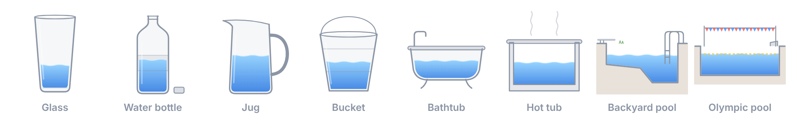

# Waterline



A glass beside your Claude Code session that fills as you work. After each reply, Waterline turns that reply's token counts into an estimate of the water used to serve it, and a drop falls into the glass. As the total grows, the glass gives way to a water bottle, a jug, a bucket, a bathtub, a hot tub, a backyard pool and, eventually, an Olympic pool.

## Where it works

Waterline is a Claude Code plugin built as a mod, so it runs wherever Claude Code loads mods:

- **The `claude` terminal.** The vessel is drawn in coloured half-block characters. The panel shows when the terminal has room for it, or when you type `/waterline`.
- **The Code tab of the Claude desktop app**, with the full drawing.
- **The VS Code extension**, with the full drawing.

Regular claude.ai chats on the web, desktop and mobile apps don't load mods, so Waterline doesn't show there.

## Install

From Anthropic's plugin directory, once it's listed: run `/plugin directory` in Claude Code, or add it from **Customize > Plugins** on claude.ai, which syncs it to Claude Code.

From this repository, at the prompt of a terminal session:

```
/plugin install waterline --marketplace alibabaskill/aiwateruse
```

From a shell:

```
claude plugin install waterline --marketplace alibabaskill/aiwateruse
```

In the desktop app: click **+** next to the prompt box, then **Plugins**, **Add marketplace** with `alibabaskill/aiwateruse`, then **Add plugin**.

## Use

- The panel opens by itself at the start of a session. Close it and it stays closed in later sessions; `/waterline` brings it back.
- `/waterline low`, `/waterline mid` and `/waterline high` switch the estimate (Mid is the default). The buttons in the panel do the same.
- `/waterline reset` empties the glass and forgets everything Waterline saved: the totals, the estimate you chose and the panel setting.
- A 💧 line under the prompt keeps the running total and what the last reply added.
- Where your machine has history, the panel also shows today's total, the all-time total and the last seven days.

## What it can and can't do

Waterline is about 1,300 lines of readable TypeScript with no dependencies, no build step and nothing compiled or minified.

It can:

- read each turn's token counts when the turn ends (the four numbers the API reports) and the turn's id, so a repeated turn counts once; never your messages, Claude's replies or tool calls;
- draw its panel, its line under the prompt, and a short notice when a vessel fills;
- add the `/waterline` command;
- keep a few numbers in its own small store, a JSON file Claude Code keeps for it in your Claude configuration folder: the estimate you chose, whether the panel opens by itself, and totals in weighted tokens (all time, and by day for the last two weeks).

It doesn't:

- make network requests (the source links in the panel open only when you click them);
- read or write any of your files, start processes or run commands;
- call a model or spend your usage;
- see, change, approve or block your prompts, tool calls or permissions.

You can check this before installing. `claude plugin validate` lists the events a mod hooks and the `$` calls in its source; for Waterline it prints, among other lines:

```
> ./register.tsx hooks: session.start, turn.complete, ui.close{id=waterline}, command.run{command=waterline}, ui.render{component=Pane, requestId=waterline}
> ./register.tsx calls: $.clock.now, $.command.register, $.state.get, $.state.set, $.store.delete (via reset), $.store.get, $.store.set, $.ui.open, $.ui.resolve, $.ui.status (via pour, refreshStatus), $.ui.toast (via pour)
```

The `ui.close` hook always lets the panel close and only remembers that you closed it. Claude Code hands every plugin that listens for the end of a turn the turn's final text along with its token counts; Waterline reads only the counts and the turn's id. Only you can reset Waterline or change its settings: another plugin running `/waterline` can only open the panel.

## How the estimate works

Each turn's tokens are weighted by Anthropic's price ratios, as a stand-in for the computing they take: output 1, new input 0.2, cache writes 0.25, cache reads 0.02. A typical reply, about 400 output tokens plus its prompt, counts as 500 weighted tokens, and each estimate says how much water such a reply uses:

| Estimate | Per typical reply | What it counts |
| --- | --- | --- |
| Low | 0.26 mL | Data-centre cooling only. Google's measured figure for a median Gemini prompt ([Aug 2025](https://arxiv.org/pdf/2508.15734)). |
| Mid (default) | about 1.3 mL | The same, plus the water power plants use making the electricity: 0.24 Wh at 4.52 L per kWh, the 2023 US average ([TechTarget](https://www.techtarget.com/it-infrastructure/news/366650693/A-shadow-water-problem-AIs-power-demand-shifts-consumption-upstream)). |
| High | 45 mL | Mistral's life-cycle figure for a 400-token reply ([Jul 2025](https://simonwillison.net/2025/Jul/22/mistral-environmental-standard/)), the broadest accounting published. |

Anthropic doesn't publish a water figure for Claude, so treat Waterline as a rough guide, not a meter. The three estimates are far apart because they count different things. At Mid a short chat stays within the glass, while a long agentic session, where one prompt can run many model requests, can reach a bottle or a jug.

### Limits

- Only model turns are counted. Requests outside a turn, such as compacting a long conversation, aren't.
- Days follow the time zone Claude Code runs in.
- Two sessions on one machine that finish turns at the same moment can undercount the shared totals slightly.

## Development

The plugin is the folder itself: `hooks/register.tsx` handles the events, `hooks/water.ts` holds the estimate and the drawings, and `tests/` covers every surface. Run the checks with:

```
claude plugin validate .
claude plugin test .
```

## License

[MIT](LICENSE)
